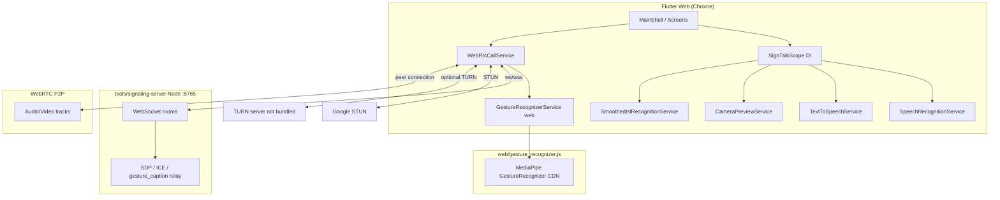

# SignTalk — Project Knowledge Base (KB)

**Purpose:** Single source of truth for vision, problem statement, architecture, roadmap, deployment, and team workflow.  
**Audience:** Project team, IEEE reviewers, judges, and AI assistants working in this repo.  
**Last updated:** 2026-10-17 (generated from codebase + existing docs).  
**Maintainers:** Update this file when milestones, URLs, or scope change—do not rely on chat history alone.

---

## 1. Elevator pitch

**SignTalk** is an assistive **Flutter Web** application that helps **Indian Sign Language (ISL) users** and **non-signers** communicate through **speech ↔ text**, **conversation assistance**, and **real-time video calls** with optional **gesture-based captions** during calls.

**Tagline (from README):** *Bridging communication through speech, text, and Indian Sign Language.*

**Current honesty boundary:** The app is a **development-stage / major-project prototype**. Live **validated ISL recognition is not connected**. In-call gestures use **MediaPipe** mapped to three **English demo labels** (HELLO / YES / STOP)—**not** certified ISL signs.

---

## 2. Problem statement

### 2.1 Social / accessibility problem

- Deaf and hard-of-hearing people who use **ISL** often face a **communication gap** with hearing people who do not sign.
- Everyday channels (phone calls, quick video chat, ad-hoc conversations) rarely offer **bidirectional** support: **sign → text/speech** and **speech → text** in one accessible UI.
- Existing tools are often fragmented (separate STT apps, no sign integration, no in-call assistance) or require **interpreters**, which are not always available.

### 2.2 Technical problem

- **Sign language recognition** needs camera input, low latency, and a **trained model** (ISL-specific)—hard to ship correctly without validation.
- **WebRTC video calling** on **mobile browsers** requires **HTTPS (secure context)**, signaling, **STUN/TURN**, and careful firewall/tunnel setup.
- A **major project / IEEE demo** must show a **credible end-to-end story** (real media, real relay) while being clear about **prototype limits**.

### 2.3 What SignTalk solves *today* (prototype scope)

| Need | Approach in repo |
|------|------------------|
| Hearing person speaks → text | Browser **Speech-to-Text** (`speech_to_text` / Web Speech API on Chrome) |
| Text → spoken output | **TTS** (`flutter_tts` / `speechSynthesis` on web) |
| Compose & share messages | **Conversations** + **ConversationDraft** staging from translate screens |
| Remote face-to-face communication | **WebRTC** audio/video + **Node WebSocket signaling** |
| Sign-related demo during call | **MediaPipe Gesture Recognizer** in browser → caption relay via **`gesture_caption`** on signaling |
| Future ISL model | **Pluggable `IslRecognitionAdapter`** (currently **`DisconnectedIslRecognitionAdapter`**) |

### 2.4 What SignTalk does *not* claim yet

- Certified **ISL translator** or medical/legal-grade accessibility product.
- Full **ISL vocabulary**, **sentence grammar**, or **avatar signing** from arbitrary text (only static **TextToSignReference** gloss hints).
- Production **TURN** infrastructure bundled in repo (STUN-only by default).
- Native Android/iOS apps (focus is **Flutter Web** + Chrome).

---

## 3. Vision and solution narrative (for IEEE / judges)

**Story arc (60–90 seconds):** See `docs/JUDGE_DEMO_GUIDE.md` §11.

1. **Problem:** Communication barrier between ISL users and non-signers in real-time conversations.
2. **Idea:** One app combining **translation modes** + **live video** + **assistive captions/TTS**.
3. **Prototype proof:** Two browsers join the **same room** → **real WebRTC video** (not fake UI).
4. **Sign assist demo:** Camera detects **three prototype hand poses** → sends **HELLO / YES / STOP** to the remote peer via signaling.
5. **Future:** Connect a **validated ISL model** via adapter; add **TURN**, richer vocabulary, accessibility testing.

---

## 4. Roadmap — phases and status

Aligned with `README.md` roadmap and current implementation.

| Phase | Goal | Status | Evidence in repo |
|-------|------|--------|------------------|
| **P0 — Foundation** | Flutter app shell, design system, navigation | **Done** | `lib/app/`, `lib/screens/`, `stitch_signtalk_*` design refs |
| **P1 — Speech & text** | STT, TTS, settings, text scale | **Done** | `lib/services/speech/`, `settings_screen.dart` |
| **P2 — Sign-to-text UX** | Camera preview, adapter hook, honest “not connected” UX | **Done (no model)** | `sign_to_text_screen.dart`, `isl_recognition_adapter.dart` |
| **P3 — Conversations** | Draft messages, conversation UI | **Done** | `conversation_draft.dart`, `conversations_screen.dart` |
| **P4 — WebRTC calling** | Host/join, media state, ICE buffer, diagnostics | **Implemented; validate on 2 devices** | `webrtc_call_service.dart`, `video_call_screen.dart` |
| **P5 — Demo gestures in call** | MediaPipe web, caption relay, debounce | **Done (3 gestures)** | `web/gesture_recognizer.js`, `gesture_demo_labels.dart` |
| **P6 — Secure public demo** | HTTPS + WSS tunnels, paired config | **Documented + config file** | `docs/WEBRTC_*`, `sign_talk_public_demo_config.dart` |
| **P7 — Real ISL model** | Sidecar/TFLite/HTTP adapter, smoothing | **Not connected** | `DisconnectedIslRecognitionAdapter` |
| **P8 — Production hardening** | TURN, tests, a11y audit, deployment | **Partial** | Tests exist; TURN via `--dart-define` only |

### Recommended fast path (time-constrained major project)

1. **Freeze demo scope:** WebRTC + 3 gestures + STT/TTS in call UI (`JUDGE_DEMO_GUIDE.md`).
2. **Validate checklist:** Two devices, **Media connected**, remote video visible, caption relay works.
3. **Update tunnel URLs** in `sign_talk_public_demo_config.dart` after each Cloudflare restart.
4. **Run CI locally:** `flutter analyze`, `flutter test`, `npm test` in signaling server.
5. **Parallel track (if time):** ISL adapter implementation behind `IslRecognitionAdapter` without breaking demo path.

---

## 5. System architecture

### 5.1 High-level diagram



### 5.2 Application composition (dependency injection)

Root widget **`SignTalkApp`** wires services into **`SignTalkScope`** (InheritedWidget):

| Service | Role |
|---------|------|
| `SignTalkPreferences` | Text scale, TTS prefs (SharedPreferences / localStorage) |
| `SpeechRecognitionService` | Platform STT wrapper |
| `TextToSpeechService` | Platform TTS (+ web implementation split) |
| `CameraPreviewService` | Web getUserMedia preview for Sign-to-Text |
| `ConversationDraft` | Staging text from Translate → Conversations |
| `SmoothedIslRecognitionService(DisconnectedIslRecognitionAdapter())` | ISL hook; returns *not connected* |
| `DevicePermissionStatus` | Permission messaging for Settings |

Entry: `lib/main.dart` → `SignTalkApp` → `MainShell` (4 tabs: Home, Translate, Conversations, Settings).

### 5.3 Navigation map

| Tab | Screens / flows |
|-----|-----------------|
| **Home** | Entry cards → Sign to Text, Speech to Text, Conversations |
| **Translate** | Toggle Sign-to-Text / Speech-to-Text |
| **Conversations** | Message UI; opens **VideoCallScreen** overlay |
| **Settings** | Permissions, TTS, accessibility text scale |

**Video call** replaces tab body (no bottom nav) while active.

---

## 6. Feature modules (deep dive)

### 6.1 Speech-to-Text

- **Package:** `speech_to_text`
- **Web:** Browser **Web Speech API** (Chrome/Edge). Limitations documented in `lib/services/speech/BROWSER_SPEECH_LIMITATIONS.md`.
- **In-call:** `VideoCallScreen` uses `SpeechTranscriptController` for live captions into assist field.

### 6.2 Text-to-Speech

- **Package:** `flutter_tts`; web-specific helpers in `text_to_speech_web.dart` / stub.
- **Uses:** Sign-to-Text “Speak”, settings, optional **remote gesture** announcement in call.

### 6.3 Sign-to-Text (offline from model)

- **Camera:** `CameraPreviewService` (web implementation).
- **Recognition:** Calls `islRecognition.recognizeClip(...)` → **`DisconnectedIslRecognitionAdapter`** message.
- **UX:** User can type/paste text; **TextToSignReference** gives static gloss hints (INCLUDE-50 subset)—not video avatars.

### 6.4 WebRTC calling

- **Package:** `flutter_webrtc`
- **Core class:** `WebRtcCallService` (`ChangeNotifier`)
  - Local/remote `RTCVideoRenderer`
  - Signaling over `web_socket_channel`
  - States: connection, media access, signaling joined, media path (remote tracks)
  - **`IceCandidateBuffer`** for trickle ICE ordering
- **Config:** `WebRtcCallConfig`
  - Default STUN: `stun:stun.l.google.com:19302`
  - Optional: `--dart-define=TURN_URL`, `TURN_USERNAME`, `TURN_CREDENTIAL`
  - Signaling: `--dart-define=SIGNALING_URL=wss://...` or auto-pair via `SignTalkPublicDemoConfig`

### 6.5 Signaling server

- **Path:** `tools/signaling-server/`
- **Port:** `8765` (`SIGNALING_PORT` env override)
- **Health:** HTTP GET → `SignTalk signaling server OK`
- **Room logic:** `signaling-room.js` (+ tests in `test/signaling-room.test.js`)
- **Relayed message types:** `offer`, `answer`, `candidate`, **`gesture_caption`**
- **Not provided:** TURN, TLS termination (use reverse proxy / Cloudflare tunnel)

### 6.6 In-call gesture pipeline (prototype)

- **JS:** `web/gesture_recognizer.js` — MediaPipe **tasks-vision** from CDN, ~12 FPS throttle.
- **Dart:** Conditional import `gesture_recognizer_web.dart` vs `gesture_recognizer_stub.dart`.
- **Demo mapping:** `GestureDemoLabels` — `Open_Palm`→HELLO, `Thumb_Up`→YES, `Closed_Fist`→STOP.
- **Behavior:** Release + cooldown before repeat; only demo gestures sent over signaling.
- **Remote video:** Optional second channel to show/detect partner video locally (display/TTS; sending still from local camera pipeline).

### 6.7 ISL integration (future-proofing)

- **`IslRecognitionAdapter`:** implement `recognizeClip(jpegFrames)` for sidecar HTTP, WASM, TFLite, etc.
- **`IslPredictionSmoother`:** stabilizes noisy model output (tested).
- **Swap-in point:** `SignTalkApp` — replace `DisconnectedIslRecognitionAdapter()` with real adapter when ready.

---

## 7. Repository layout

| Path | Description |
|------|-------------|
| `lib/app/` | App root, scope, main shell |
| `lib/screens/` | UI: home, translate, conversations, video call, settings |
| `lib/services/speech/` | STT/TTS |
| `lib/services/gesture/` | Gesture service + demo labels |
| `lib/services/isl/` | ISL adapter, smoother, text-to-sign reference |
| `lib/services/webrtc/` | Call service, config, ICE buffer, demo Cloudflare pairing |
| `lib/services/media/` | Camera preview (web/stub) |
| `lib/services/communication/` | Conversation draft |
| `lib/theme/` | Colors, Material theme |
| `web/` | `index.html`, `gesture_recognizer.js`, demo sounds (`hello.wav`, etc.) |
| `tools/signaling-server/` | Node signaling + `signaling-logic.js` |
| `test/` | Dart unit tests |
| `docs/` | Deployment, judge guide, **this KB** |
| `stitch_signtalk_accessible_ui_design/` | Stitch HTML mockups + DESIGN.md tokens |

---

## 8. Technology stack

| Layer | Choice |
|-------|--------|
| UI framework | Flutter 3.x / Dart SDK ^3.13.5 |
| Primary target | **Web** (Chrome); mobile-width layout (~390px constraint in shell) |
| Real-time media | `flutter_webrtc` |
| Signaling | Node.js + `ws`, WebSocket rooms |
| STT / TTS | `speech_to_text`, `flutter_tts` |
| Gesture ML (demo) | MediaPipe Gesture Recognizer (browser CDN) |
| Persistence | `shared_preferences` |
| Design | Material 3-ish custom theme; Inter; teal/mint palette (see Stitch DESIGN.md) |

---

## 9. Running and deploying

### 9.1 Local dev (minimum)

```powershell
# Terminal 1
cd tools/signaling-server
npm install
npm start

# Terminal 2
cd <repo root>
flutter pub get
flutter run -d web-server --web-hostname 0.0.0.0 --web-port 8080
```

### 9.2 Two-device / phone demo

- **Problem:** Android Chrome often blocks camera on `http://LAN-IP`.
- **Fix:** HTTPS app URL + **separate WSS** signaling tunnel.
- **Guides:**
  - `docs/JUDGE_DEMO_GUIDE.md` — step-by-step for judges
  - `docs/WEBRTC_DEPLOYMENT.md` — checklist, ports, firewall
  - `docs/WEBRTC_SECURE_DEMO.md` — TLS/WSS concepts
  - `docs/CLOUDFLARE_QUICK_DEMO.md` — quick tunnel notes (HEAD vs GET 502)

### 9.3 Public demo URL pairing

Edit **`lib/services/webrtc/sign_talk_public_demo_config.dart`**:

- `cloudflareAppHost` — HTTPS app hostname (no scheme)
- `cloudflareSignalingWss` — `wss://...` from second tunnel

**Note:** Quick tunnel hostnames **change every restart**—update before demos.

### 9.4 Quality gates before presentation

```powershell
flutter analyze
flutter test
cd tools/signaling-server
npm test
```

Manual: two browsers, same room ID, verify **Connected — remote media active** and gesture chips **You:** / **Them:**

---

## 10. Team collaboration guide

### 10.1 Suggested workstreams (parallel)

| Stream | Owner focus | Touch mainly |
|--------|-------------|--------------|
| **A — WebRTC & infra** | Signaling, TURN, tunnels, firewall docs | `tools/signaling-server/`, `webrtc_*` |
| **B — UI/UX & a11y** | Screens, contrast, touch targets, copy | `lib/screens/`, `theme/`, Stitch refs |
| **C — Speech** | STT/TTS edge cases, in-call captions | `lib/services/speech/` |
| **D — Sign/ML** | ISL adapter, model sidecar, smoothing tuning | `lib/services/isl/`, future model repo |
| **E — Gesture demo** | MediaPipe tuning, demo labels, relay | `web/gesture_recognizer.js`, `video_call_screen.dart` |
| **F — QA & docs** | Tests, judge script, KB updates | `test/`, `docs/` |

### 10.2 Branch / PR discipline

- **Do not commit** TURN credentials or `.env` secrets (`turn.env.example` is template only).
- **Small PRs** per stream; run `flutter analyze` + `flutter test` before merge.
- **Update this KB** when: demo URLs change, adapter connected, scope changes for IEEE.

### 10.3 Definition of Done (demo milestone)

- [ ] Signaling + Flutter + tunnels documented and reproducible by teammate
- [ ] Two devices: remote **video+audio** confirmed
- [ ] Three gestures relay with **Them:** chip on receiver
- [ ] Judge script rehearsed (`JUDGE_DEMO_GUIDE.md`)
- [ ] Limitations stated clearly (not full ISL)

---

## 11. Testing inventory

| Test file | Covers |
|-----------|--------|
| `webrtc_call_config_test.dart` | Signaling URL logic, tunnel hosts |
| `ice_candidate_buffer_test.dart` | ICE buffering |
| `gesture_demo_labels_test.dart` | Demo caption mapping |
| `isl_prediction_smoother_test.dart` | Smoothing |
| `disconnected_isl_adapter_test.dart` | Default adapter behavior |
| `text_to_sign_reference_test.dart` | Gloss hints |
| `widget_test.dart` | Basic widget smoke |
| `signaling-room.test.js` | Join/relay including `gesture_caption` |

---

## 12. Design and accessibility intent

From Stitch **SignTalk** / **Design System** (`stitch_signtalk_accessible_ui_design/.../DESIGN.md`):

- **Human-centered**, calm teal/mint UI—not clinical.
- **Light mode** for contrast with camera feeds.
- **48×48px** minimum touch targets; Inter typography; generous spacing.
- Components: pill buttons, cards, gesture feedback rings (design intent; partial implementation in Flutter theme).

---

## 13. Glossary

| Term | Meaning in SignTalk |
|------|---------------------|
| **ISL** | Indian Sign Language |
| **Secure context** | HTTPS or localhost; required for getUserMedia on many devices |
| **Signaling** | WebSocket server exchanging SDP/ICE (not media) |
| **STUN/TURN** | NAT traversal; STUN default, TURN for hard networks |
| **Adapter** | `IslRecognitionAdapter` plug-in point for real models |
| **Demo gesture** | MediaPipe category mapped to HELLO/YES/STOP only |
| **ConversationDraft** | In-memory staged message from Translate tab |

---

## 14. Known limitations & risks (keep in presentations)

1. **Not ISL-validated signs** for gesture demo—English labels from MediaPipe categories.
2. **ISL model disconnected** on Sign-to-Text screen (camera works).
3. **STUN-only** may fail → black remote video; need TURN for production.
4. **Cloudflare quick tunnels** ephemeral, not for production auth/security.
5. **Web Speech** privacy/network dependency on Chrome.
6. **Gesture model** loads from Google/CDN—needs internet first run.

---

## 15. Work-in-progress snapshot (2026-10-17)

From recent development (may differ after your next commit):

- Enhanced **video call** + gesture pipelines + TTS web split
- **`gesture_demo_labels.dart`**, **`signaling-logic.js`**, demo **WAV** sounds under `web/sounds/`
- **`sign_talk_public_demo_config.dart`** — paired Cloudflare hosts (update before demo)
- Docs: **`JUDGE_DEMO_GUIDE.md`**, **`CLOUDFLARE_QUICK_DEMO.md`**

Always run `git status` for authoritative delta.

---

## 16. How AI assistants should use this KB

1. **Read this file first** for scope, honesty boundaries, and architecture.
2. **Search by section** (WebRTC, ISL, gestures, deployment) instead of re-scanning the whole repo.
3. **Follow linked docs** for procedural steps (`JUDGE_DEMO_GUIDE.md` for demos).
4. **Do not assume** ISL recognition works—verify adapter class in `sign_talk_app.dart`.
5. **After meaningful changes**, append a short bullet to §15 or update §4 status table.

### Quick lookup index

| Question | Go to |
|----------|--------|
| What is the problem? | §2 |
| What's done vs todo? | §4 |
| How does calling work? | §6.4, §6.5, §5.1 |
| How to demo for judges? | `docs/JUDGE_DEMO_GUIDE.md` + §9 |
| Where to plug ISL model? | §6.7, `IslRecognitionAdapter` |
| Default signaling URL logic? | `WebRtcCallConfig`, §6.4 |
| Demo gesture mappings? | `GestureDemoLabels`, §6.6 |

---

## 17. Related documents (canonical)

| Document | Use when |
|----------|----------|
| `README.md` | First-time clone, high-level features |
| `docs/JUDGE_DEMO_GUIDE.md` | IEEE/judge live demo |
| `docs/WEBRTC_DEPLOYMENT.md` | LAN + tunnel deployment |
| `docs/WEBRTC_SECURE_DEMO.md` | HTTPS/WSS setup |
| `docs/CLOUDFLARE_QUICK_DEMO.md` | Cloudflare-specific pitfalls |
| `tools/signaling-server/README.md` | Signaling server only |
| `lib/services/speech/BROWSER_SPEECH_LIMITATIONS.md` | STT on web |

---

*End of SignTalk Knowledge Base.*
